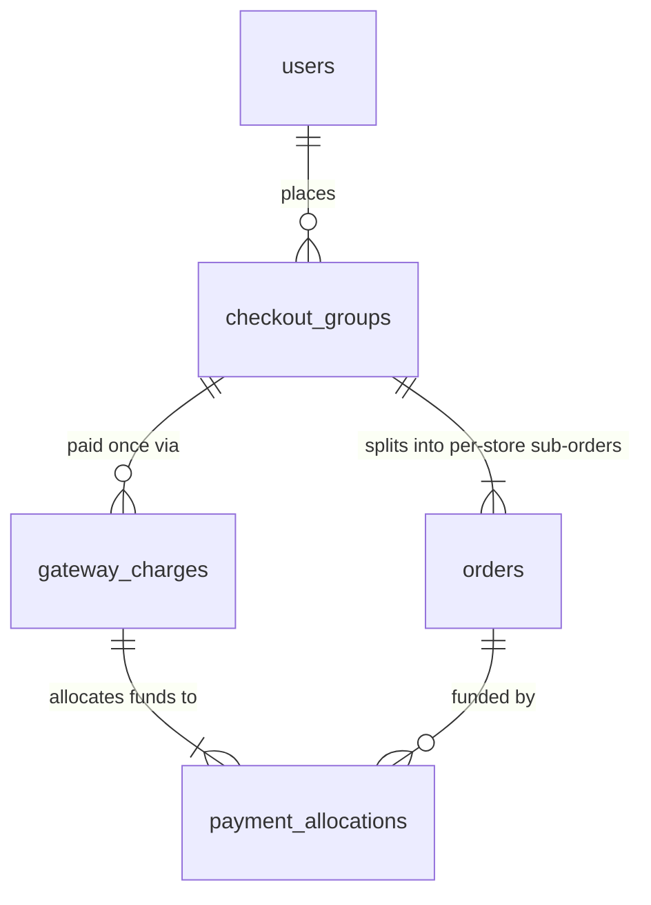

# CuteCart Multi-Store Checkout Extension Plan (T2.8)

**Owner:** M2 (Database, Search, Background Jobs)  
**Status:** Future Extension Blueprint (Schema v2 Proposal)  
**Current v1 Constraint:** One cart per store; one order belongs to one store.

---

## 1. Problem Statement

In CuteCart v1, carts and orders are strictly single-store (`carts.store_id` and `orders.store_id` are `NOT NULL`). This keeps tenant isolation, shipping calculation, coupon validation, inventory transactions, and fulfillment simple and rock-solid.

Later, customers may want to add stationery from **PaperPetal Studio (Lahore)** and **Kawaii Craft Co. (Karachi)** into a single basket and pay **once** at checkout, while each store still fulfills, ships, and refunds its own portion independently without ever seeing another store's data.

---

## 2. Target Architecture: Parent Customer Order + Per-Store Sub-Orders

Instead of breaking the single-store invariant on `orders`, we introduce a **parent wrapper** above `orders`:

- **`checkout_groups` (Parent Customer Order):** Represents a single buyer checkout event spanning 1..N stores, holding the combined customer receipt number (`CCG-2026-00001`), aggregated grand total in PKR, and the single gateway payment intent.
- **`orders` (Per-Store Sub-Orders):** Remains unchanged in its core tenant isolation! Each row still belongs to exactly **one `(tenant_id, store_id)`**, carries its own status state machine, shipping fee, store coupon, invoice, and shipment(s), and adds only a nullable `checkout_group_id UUID FK`.

---

## 3. Exact Schema Changes Required (Backwards-Compatible)

1. **New Table: `checkout_groups`** (customer-scoped, NOT store-scoped):
   - `id UUID PK`, `user_id UUID FK -> users(id)`, `group_number TEXT UNIQUE`, `idempotency_key TEXT`, `grand_subtotal_pkr NUMERIC(12,2)`, `grand_discount_pkr NUMERIC(12,2)`, `grand_shipping_pkr NUMERIC(12,2)`, `grand_tax_pkr NUMERIC(12,2)`, `grand_total_pkr NUMERIC(12,2)`, `currency CHAR(3) DEFAULT 'PKR'`, `status TEXT` (`pending_payment`, `confirmed`, `partially_fulfilled`, `completed`, `partially_refunded`, `cancelled`), `created_at TIMESTAMPTZ`.
   - RLS policy: visible only to `user_id = app_current_user_id()` or `platform_admin` (sellers never query `checkout_groups` directly).

2. **Minimal Column Addition on `orders`:**
   - `ALTER TABLE orders ADD COLUMN checkout_group_id UUID REFERENCES checkout_groups(id) ON DELETE RESTRICT;`
   - `CREATE INDEX idx_orders_checkout_group ON orders(checkout_group_id) WHERE checkout_group_id IS NOT NULL;`
   - Existing v1 single-store orders simply have `checkout_group_id = NULL` (zero breaking changes).

3. **Split Payment Accounting (`gateway_charges` + `payment_allocations`):**
   - A single customer gateway payment (e.g., PKR 4,500.00 via Stripe) is stored in `gateway_charges`, and one `payments` row per sub-order links via `gateway_charge_id` with its exact store share (e.g., PKR 2,500.00 for Store A + PKR 2,000.00 for Store B).
   - Database constraint/verification ensures `SUM(payments.amount_pkr) = gateway_charges.amount_pkr` before marking the group paid.
   - Refunds remain scoped to individual `(tenant_id, store_id, order_id, payment_id)` rows and trigger partial gateway refunds against `gateway_charges.provider_charge_id`.

4. **Unified Cart Basket:**
   - Keep existing per-store `carts` rows intact. The frontend groups a user's active per-store `carts` into one multi-store cart UI by store section, allowing per-store shipping options and per-store coupons.

---

## 4. Transactional & Tenant-Safety Impact

- **Atomic Checkout:** One PostgreSQL transaction locks all requested `inventory` rows sorted by `variant_id` (preventing deadlocks), creates 1 `checkout_groups` row + $N$ `orders` rows + `order_items` + `order_status_history`. If Store B is out of stock, the entire transaction rolls back cleanly.
- **Tenant Isolation Preserved:** Every composite FK `(tenant_id, store_id, ...)` and every RLS policy on `orders`, `order_items`, `payments`, `shipments`, and `refunds` remains **100% intact**. Store A still cannot read Store B's sub-order even when both share a `checkout_group_id`.
- **Zero-Downtime Rollout:** Additive-only migration (`NULL`-able `checkout_group_id`) -> deploy v2 checkout endpoint -> keep v1 single-store checkout working alongside it -> deprecate v1 once frontend adopts grouped checkout.
