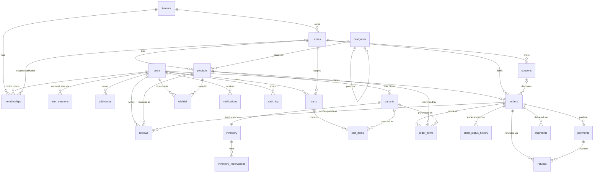

# CuteCart Database Requirements, ER Diagram & Data Dictionary (T2.1)

**Owner:** M2 (Database, Search, Background Jobs)  
**Database Engine:** PostgreSQL 16+ (replaces legacy MongoDB)  
**Scope:** Multi-tenant B2C stationery marketplace (no B2B, C2C, or C2B)

---

## 1. Core Business & Data Requirements

1. **Multi-Tenant Isolation (Database-Enforced)**
   - Independent stationery sellers operate as **tenants**, each owning one or more **stores**.
   - Tenant separation is enforced at **three layers**: application context, **composite foreign keys** `(tenant_id, store_id, ...)`, and **PostgreSQL Row-Level Security (RLS)** on all tenant-scoped tables under a least-privilege runtime role (`cutecart_app` with `NOBYPASSRLS`).
   - Anyone (including unauthenticated visitors) may browse **published** products belonging to **active** stores.
   - Seller, staff, and store-admin mutations derive `tenant_id` and `store_id` strictly from the authenticated user's membership — never from browser payloads.

2. **Single-Store Cart & Order Scope**
   - A shopping **cart** is scoped to a single store (`carts` belongs to one `store_id`).
   - An **order** belongs to exactly one store (`orders` belongs to one `store_id`). Multi-store checkout is planned as a future extension (see [EXTENSION_PLAN.md](./EXTENSION_PLAN.md)).
   - Composite foreign keys guarantee an `order_items` row can **only** reference a `product` and `variant` belonging to the **same** `(tenant_id, store_id)` as the parent order.

3. **Monetary, Time, and Identifier Standards**
   - **Identifiers:** `UUID` (`gen_random_uuid()`) for all primary keys.
   - **Money:** `NUMERIC(12, 2)` — never `FLOAT` or `DOUBLE PRECISION`. Currency is strictly `'PKR'`. APIs serialize money as decimal strings (e.g., `"2500.00"`).
   - **Timestamps:** `TIMESTAMPTZ` stored in UTC and serialized as ISO 8601 UTC.
   - **Server-Side Pricing:** Order subtotals, discounts, tax, shipping, and totals are always computed server-side from database variant prices and snapshotted onto `order_items` at checkout.

4. **Inventory & Concurrency Safety**
   - Price and stock live on product **variants** (SKUs) and their 1:1 `inventory` records.
   - Stock cannot go negative (`stock_quantity >= 0`, `reserved_quantity >= 0`, `reserved_quantity <= stock_quantity`).
   - Stock decrements use atomic conditional updates so two concurrent buyers racing for the last unit can never oversell.
   - Expiring checkout holds are tracked in `inventory_reservations` and swept by a scheduled `pg-boss` job.

5. **State Machines & Payment Safety**
   - **Order statuses:** `pending_payment`, `confirmed`, `processing`, `shipped`, `delivered`, `cancelled`, `returned`.
   - **Payment statuses:** `pending`, `authorized`, `completed`, `failed`, `refunded`.
   - **Shipment statuses:** `pending`, `packed`, `shipped`, `in_transit`, `delivered`, `failed`, `returned`.
   - A failed payment can never produce a paid order. Webhook events are deduplicated via unique `webhook_event_id`.
   - Every order transition is logged in `order_status_history`.

6. **Verified Reviews, Immutable Audit Trail & Privacy**
   - `reviews` require a valid `(tenant_id, store_id, order_id)` belonging to the reviewer for verified-buyer enforcement.
   - `audit_log` is append-only (`REVOKE UPDATE, DELETE` from `cutecart_app`).
   - Soft deletes (`deleted_at`) preserve referential integrity for historical orders, invoices, and accounting records (see [RETENTION_POLICY.md](./RETENTION_POLICY.md)).

---

## 2. Entity-Relationship Diagram (ERD)

Notation: `||--o{` = required one to optional many; `||--|{` = required one to required many; `||--||` = required one-to-one; `|o--o{` = optional one to optional many.

---

## 3. Complete Data Dictionary

All 22 required core tables plus 2 supporting operational tables (`user_sessions` for M3 T3.1/T3.7 and `inventory_reservations` for M4 T4.4 / M5 T5.6).

### 3.1 `tenants`
| Column | Type | Null | Default | Constraints / Notes |
|---|---|---|---|---|
| `id` | `UUID` | NO | `gen_random_uuid()` | Primary Key |
| `name` | `TEXT` | NO | — | `LENGTH(TRIM(name)) >= 2` |
| `slug` | `TEXT` | NO | — | `UNIQUE`, lowercase URL-safe slug |
| `status` | `tenant_status` | NO | `'active'` | Enum: `active`, `suspended`, `archived` |
| `contact_email` | `TEXT` | NO | — | Business contact email |
| `settings` | `JSONB` | NO | `'{}'` | Tenant-level configuration |
| `created_at` | `TIMESTAMPTZ` | NO | `NOW()` | UTC |
| `updated_at` | `TIMESTAMPTZ` | NO | `NOW()` | Auto-updated trigger |
| `deleted_at` | `TIMESTAMPTZ` | YES | `NULL` | Soft delete |

### 3.2 `users`
| Column | Type | Null | Default | Constraints / Notes |
|---|---|---|---|---|
| `id` | `UUID` | NO | `gen_random_uuid()` | Primary Key |
| `email` | `TEXT` | NO | — | Unique case-insensitive (`LOWER(email)`) |
| `username` | `TEXT` | YES | `NULL` | Optional unique handle (preserves legacy MongoDB usernames) |
| `password_hash` | `TEXT` | NO | — | bcrypt hash (cost 12) |
| `needs_password_rehash` | `BOOLEAN` | NO | `FALSE` | Set `TRUE` for migrated legacy cost-10 hashes |
| `full_name` | `TEXT` | NO | — | Display name |
| `phone` | `TEXT` | YES | `NULL` | Optional phone |
| `avatar_url` | `TEXT` | YES | `NULL` | Profile image |
| `email_verified` | `BOOLEAN` | NO | `FALSE` | Email verification state |
| `is_platform_admin` | `BOOLEAN` | NO | `FALSE` | Platform-wide super-admin flag |
| `totp_secret_encrypted` | `TEXT` | YES | `NULL` | Admin MFA (T3.7), encrypted at app layer |
| `mfa_enabled` | `BOOLEAN` | NO | `FALSE` | MFA active flag |
| `last_login_at` | `TIMESTAMPTZ` | YES | `NULL` | UTC |
| `created_at` | `TIMESTAMPTZ` | NO | `NOW()` | UTC |
| `updated_at` | `TIMESTAMPTZ` | NO | `NOW()` | Auto-updated trigger |
| `deleted_at` | `TIMESTAMPTZ` | YES | `NULL` | Soft delete / anonymization timestamp |

### 3.3 `stores`
| Column | Type | Null | Default | Constraints / Notes |
|---|---|---|---|---|
| `id` | `UUID` | NO | `gen_random_uuid()` | Primary Key; also `UNIQUE (tenant_id, id)` for composite FKs |
| `tenant_id` | `UUID` | NO | — | FK -> `tenants(id)` |
| `name` | `TEXT` | NO | — | Public store display name |
| `slug` | `TEXT` | NO | — | `UNIQUE`, URL slug |
| `description` | `TEXT` | YES | `NULL` | Store bio |
| `logo_url` | `TEXT` | YES | `NULL` | Store logo |
| `status` | `store_status` | NO | `'active'` | Enum: `active`, `suspended`, `closed` |
| `currency` | `CHAR(3)` | NO | `'PKR'` | `CHECK (currency = 'PKR')` |
| `city` | `TEXT` | YES | `NULL` | Origin city (e.g., Lahore, Karachi) |
| `settings` | `JSONB` | NO | `'{}'` | Shipping rates, low-stock defaults |
| `created_at` | `TIMESTAMPTZ` | NO | `NOW()` | UTC |
| `updated_at` | `TIMESTAMPTZ` | NO | `NOW()` | UTC |
| `deleted_at` | `TIMESTAMPTZ` | YES | `NULL` | Soft delete |

### 3.4 `memberships`
| Column | Type | Null | Default | Constraints / Notes |
|---|---|---|---|---|
| `id` | `UUID` | NO | `gen_random_uuid()` | Primary Key |
| `tenant_id` | `UUID` | NO | — | FK -> `tenants(id)` |
| `store_id` | `UUID` | YES | `NULL` | Composite FK -> `stores(tenant_id, id)` |
| `user_id` | `UUID` | NO | — | FK -> `users(id)` |
| `role` | `user_role` | NO | — | Enum: `customer`, `staff`, `seller`, `platform_admin` |
| `is_active` | `BOOLEAN` | NO | `TRUE` | Membership activation flag |
| `invited_by` | `UUID` | YES | `NULL` | FK -> `users(id)` |
| `created_at` | `TIMESTAMPTZ` | NO | `NOW()` | UTC |
| `updated_at` | `TIMESTAMPTZ` | NO | `NOW()` | UTC |

### 3.5 `categories`
| Column | Type | Null | Default | Constraints / Notes |
|---|---|---|---|---|
| `id` | `UUID` | NO | `gen_random_uuid()` | Primary Key |
| `parent_id` | `UUID` | YES | `NULL` | Self-FK -> `categories(id)` (`CHECK (parent_id <> id)`) |
| `name` | `TEXT` | NO | — | Category display name |
| `slug` | `TEXT` | NO | — | `UNIQUE` |
| `icon` | `TEXT` | YES | `NULL` | Emoji or icon identifier |
| `description` | `TEXT` | YES | `NULL` | SEO description |
| `sort_order` | `INTEGER` | NO | `0` | Display ordering |
| `is_active` | `BOOLEAN` | NO | `TRUE` | Visibility flag |
| `created_at` | `TIMESTAMPTZ` | NO | `NOW()` | UTC |
| `updated_at` | `TIMESTAMPTZ` | NO | `NOW()` | UTC |

### 3.6 `products`
| Column | Type | Null | Default | Constraints / Notes |
|---|---|---|---|---|
| `id` | `UUID` | NO | `gen_random_uuid()` | Primary Key; `UNIQUE (tenant_id, store_id, id)` |
| `tenant_id` | `UUID` | NO | — | Composite FK -> `stores(tenant_id, id)` |
| `store_id` | `UUID` | NO | — | Composite FK -> `stores(tenant_id, id)` |
| `category_id` | `UUID` | NO | — | FK -> `categories(id)` |
| `name` | `TEXT` | NO | — | `LENGTH(TRIM(name)) >= 2` |
| `slug` | `TEXT` | NO | — | `UNIQUE (store_id, slug)` |
| `description` | `TEXT` | NO | `''` | Plain text description |
| `status` | `product_status` | NO | `'draft'` | Enum: `draft`, `published`, `archived` |
| `image_url` | `TEXT` | YES | `NULL` | Primary product image |
| `gallery_urls` | `JSONB` | NO | `'[]'` | Additional images |
| `is_featured` | `BOOLEAN` | NO | `FALSE` | Storefront highlight |
| `is_bestseller` | `BOOLEAN` | NO | `FALSE` | Storefront badge |
| `seo_title` | `TEXT` | YES | `NULL` | SEO metadata |
| `seo_description` | `TEXT` | YES | `NULL` | SEO metadata |
| `search_vector` | `TSVECTOR` | YES | `NULL` | Auto-maintained FTS vector (name=A, category=B, desc=C) |
| `published_at` | `TIMESTAMPTZ` | YES | `NULL` | Set when published |
| `created_at` | `TIMESTAMPTZ` | NO | `NOW()` | UTC |
| `updated_at` | `TIMESTAMPTZ` | NO | `NOW()` | UTC |
| `deleted_at` | `TIMESTAMPTZ` | YES | `NULL` | Soft delete |

### 3.7 `variants`
| Column | Type | Null | Default | Constraints / Notes |
|---|---|---|---|---|
| `id` | `UUID` | NO | `gen_random_uuid()` | Primary Key; `UNIQUE (tenant_id, store_id, id)` |
| `tenant_id` | `UUID` | NO | — | Composite FK -> `products(tenant_id, store_id, id)` |
| `store_id` | `UUID` | NO | — | Composite FK -> `products(tenant_id, store_id, id)` |
| `product_id` | `UUID` | NO | — | Composite FK -> `products(tenant_id, store_id, id)` |
| `sku` | `TEXT` | NO | — | `UNIQUE (store_id, sku)` |
| `title` | `TEXT` | NO | `'Default'` | Variant label |
| `price_pkr` | `NUMERIC(12,2)` | NO | — | `CHECK (price_pkr > 0)` |
| `compare_at_price_pkr` | `NUMERIC(12,2)` | YES | `NULL` | `CHECK (compare_at_price_pkr IS NULL OR compare_at_price_pkr >= price_pkr)` |
| `currency` | `CHAR(3)` | NO | `'PKR'` | `CHECK (currency = 'PKR')` |
| `color` | `TEXT` | YES | `NULL` | Optional color facet |
| `size` | `TEXT` | YES | `NULL` | Optional size facet |
| `attributes` | `JSONB` | NO | `'{}'` | Extensible attributes |
| `image_url` | `TEXT` | YES | `NULL` | Variant image override |
| `is_active` | `BOOLEAN` | NO | `TRUE` | Active SKU flag |
| `created_at` | `TIMESTAMPTZ` | NO | `NOW()` | UTC |
| `updated_at` | `TIMESTAMPTZ` | NO | `NOW()` | UTC |
| `deleted_at` | `TIMESTAMPTZ` | YES | `NULL` | Soft delete |

### 3.8 `inventory` & 3.9 `inventory_reservations`
- `inventory`: `id`, `tenant_id`, `store_id`, `variant_id` (UNIQUE + composite FK -> `variants`), `stock_quantity` (`>= 0`), `reserved_quantity` (`>= 0 AND <= stock_quantity`), `low_stock_threshold` (`>= 0`), `updated_at`.
- `inventory_reservations` *(supporting T4.4 & T5.6)*: `id`, `tenant_id`, `store_id`, `variant_id`, `cart_id`, `order_id`, `quantity` (`> 0`), `status` (`active`, `committed`, `released`, `expired`), `expires_at`, `created_at`, `updated_at`.

### 3.10 `carts` & 3.11 `cart_items`
- `carts`: `id`, `tenant_id`, `store_id`, `user_id` (nullable), `guest_token` (nullable), `currency` (`PKR`), `abandoned_notified_at`, `expires_at`, `created_at`, `updated_at`. `CHECK (user_id IS NOT NULL OR guest_token IS NOT NULL)`. Partial unique indexes on `(store_id, user_id)` and `(store_id, guest_token)`.
- `cart_items`: `id`, `tenant_id`, `store_id`, `cart_id`, `variant_id`, `quantity` (`1..100`), `custom_options`, `created_at`, `updated_at`. Composite FKs enforce cart & variant belong to the same `(tenant_id, store_id)`. `UNIQUE (cart_id, variant_id)`.

### 3.12 `coupons`
- `id`, `tenant_id`, `store_id`, `code`, `discount_type` (`percent` | `fixed`), `discount_value` (`NUMERIC(12,2)`, `> 0`, `<= 100` for percent), `min_spend_pkr`, `max_uses`, `used_count`, `starts_at`, `expires_at`, `is_active`, `created_at`, `updated_at`. `UNIQUE (store_id, UPPER(code))`.

### 3.13 `orders`, 3.14 `order_items`, 3.15 `order_status_history`
- `orders`: `id`, `tenant_id`, `store_id`, `user_id`, `coupon_id`, `order_number` (UNIQUE), `idempotency_key` (`UNIQUE (store_id, user_id, idempotency_key)`), `status` (`order_status`), `subtotal_pkr`, `discount_pkr`, `shipping_pkr`, `tax_pkr`, `total_pkr` (`CHECK total = subtotal - discount + shipping + tax`), `currency` (`PKR`), `shipping_address` (JSONB), `shipping_method`, `notes`, `placed_at`, `created_at`, `updated_at`.
- `order_items`: `id`, `tenant_id`, `store_id`, `order_id`, `product_id`, `variant_id`, `product_name`, `variant_sku`, `unit_price_pkr`, `quantity`, `line_total_pkr` (`= unit_price_pkr * quantity`), `currency`, `custom_options`, `created_at`. **Composite FKs to `orders`, `products`, and `variants` on `(tenant_id, store_id, id)` prevent cross-store line items.**
- `order_status_history`: `id`, `tenant_id`, `store_id`, `order_id`, `from_status`, `to_status`, `changed_by`, `reason`, `created_at`.

### 3.16 `payments`, 3.17 `shipments`, 3.18 `refunds`
- `payments`: `id`, `tenant_id`, `store_id`, `order_id`, `provider`, `method` (`gateway` | `cod`), `status` (`payment_status`), `amount_pkr`, `currency`, `provider_payment_id` (partial UNIQUE), `webhook_event_id` (partial UNIQUE for webhook idempotency), `verified_at`, `failure_reason`, `metadata`, `created_at`, `updated_at`.
- `shipments`: `id`, `tenant_id`, `store_id`, `order_id`, `carrier`, `tracking_number` (partial UNIQUE per carrier), `status` (`shipment_status`), `shipped_at`, `delivered_at`, `estimated_delivery_at`, `created_at`, `updated_at`.
- `refunds`: `id`, `tenant_id`, `store_id`, `order_id`, `payment_id`, `amount_pkr`, `currency`, `status` (`refund_status`), `reason`, `requested_by`, `approved_by`, `provider_refund_id`, `created_at`, `updated_at`.

### 3.19 `reviews`, 3.20 `wishlist`, 3.21 `addresses`
- `reviews`: `id`, `tenant_id`, `store_id`, `product_id`, `user_id`, `order_id` (composite FK -> `orders`), `rating` (`1..5`), `title`, `body`, `is_verified_purchase`, `created_at`, `updated_at`, `deleted_at`. `UNIQUE (user_id, product_id, order_id)`.
- `wishlist`: `id`, `user_id`, `tenant_id`, `store_id`, `product_id`, `created_at`. `UNIQUE (user_id, product_id)`.
- `addresses`: `id`, `user_id`, `label`, `recipient_name`, `phone`, `line1`, `line2`, `city`, `province`, `postal_code`, `country` (`PK`), `is_default`, `created_at`, `updated_at`.

### 3.22 `notifications`, 3.23 `audit_log`, 3.24 `user_sessions`
- `notifications`: `id`, `tenant_id`, `store_id`, `user_id`, `channel` (`email` | `in_app`), `template`, `subject`, `payload`, `status` (`pending` | `sent` | `failed` | `read`), `attempts`, `last_error`, `sent_at`, `read_at`, `created_at`.
- `audit_log`: `id`, `tenant_id`, `store_id`, `actor_id`, `action`, `resource_type`, `resource_id`, `metadata`, `ip_address`, `request_id`, `created_at` (append-only).
- `user_sessions`: `id`, `user_id`, `refresh_token_hash` (UNIQUE), `user_agent`, `ip_address`, `expires_at`, `revoked_at`, `created_at`.
